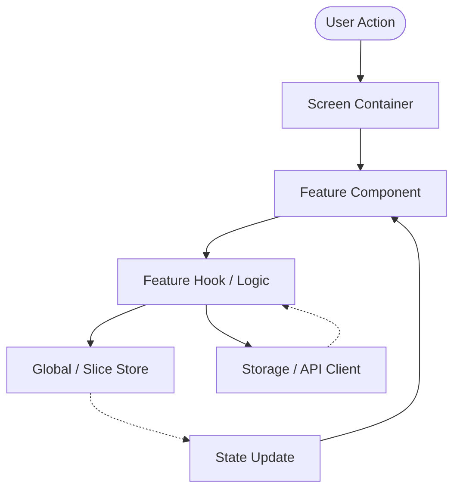

# Architecture Guide: Expenses Mobile App

## 1. Overview & Architectural Goals

The **Expenses** application is a cross-platform mobile application built with React Native and TypeScript. It is
designed to be:

- **Modular & Feature-Driven**: Domain logic is grouped by feature slices to ensure high cohesion and loose coupling.
- **Offline-First & Responsive**: Local state and persistence drive the UI immediately, minimizing latency and
  supporting offline access.
- **Strictly Typed & Maintainable**: 100% TypeScript coverage with clear separation between presentation, state, and
  native infrastructure.
- **High Performance Tooling**: Rust-powered oxidation toolchain (**oxlint** + **oxfmt**) providing sub-second linting
  and formatting without legacy ESLint/Prettier overhead.
- **Curated Asset System**: All visual iconography and illustrations utilize downloaded asset files
  from [Icons8](https://icons8.com) to maintain consistent, cohesive visual language across platforms.

---

## 2. Directory Structure

```text
my-app/
├── ios/                          # Native iOS project (Xcode, CocoaPods, AppDelegate)
├── android/                      # Native Android project (Gradle, MainActivity, Manifest)
│
├── __tests__/                    # Test suites (Jest + react-test-renderer)
│   ├── App.test.tsx              # Root App rendering & navigation smoke test
│   ├── HomeScreen.test.tsx       # HomeScreen rendering & interaction test
│   └── utils.test.ts             # Unit tests for currency and date formatting utilities
│
├── src/
│   ├── navigation/               # React Navigation setup, stacks, tabs, typed routes
│   │   ├── BottomTabNavigator.tsx# 5-tab bottom navigation with safe-area support
│   │   ├── RootNavigator.tsx     # Navigation container & theme provider
│   │   └── index.ts              # Navigation exports
│   ├── screens/                  # Top-level screen components mounted by navigators
│   │   ├── HomeScreen.tsx        # Dashboard screen (balance, quick actions, recents)
│   │   ├── TransactionsScreen.tsx# Transaction list with filter pills (All/Expense/Income)
│   │   ├── BudgetsScreen.tsx     # Monthly budget & category allocation progress
│   │   ├── AnalyticsScreen.tsx   # Savings rate & category spending distribution
│   │   ├── SettingsScreen.tsx    # User profile, app preferences, Icons8 & Google Antigravity attributions
│   │   └── index.ts              # Screens barrel export
│   ├── features/                 # Domain logic organized by feature slices
│   │   └── expenses/             # Expenses domain feature slice
│   │       ├── components/       # Feature-specific UI components
│   │       │   ├── BalanceCard.tsx
│   │       │   ├── CategorySpendingSection.tsx
│   │       │   ├── QuickActions.tsx
│   │       │   ├── RecentTransactionsList.tsx
│   │       │   └── index.ts
│   │       ├── hooks/            # Feature-specific hooks and business logic
│   │       │   └── useExpenses.ts# In-memory expense state & summary computation
│   │       ├── services/         # Feature API/persistence calls
│   │       └── types/            # Feature-scoped type definitions
│   │           └── index.ts      # Transaction, CategorySpending, ExpenseSummary types
│   ├── components/               # Shared, domain-agnostic reusable UI
│   │   ├── ui/                   # Atoms/molecules: Button, Input, Card, Badge, Text, Icon
│   │   │   ├── Badge.tsx         # Semantic badge component (success, danger, etc.)
│   │   │   ├── Button.tsx        # Multi-variant button component (primary, outline, etc.)
│   │   │   ├── Card.tsx          # Multi-variant card component (elevated, flat, outlined)
│   │   │   ├── Icon.tsx          # Typed Icons8 icon renderer
│   │   │   └── index.ts
│   │   └── layout/               # ScreenWrapper, Container, Spacer, Row, Column
│   │       ├── ScreenWrapper.tsx # Safe-area aware screen container
│   │       └── index.ts
│   ├── hooks/                    # Global/shared custom React hooks
│   ├── lib/                      # Client setup (storage, API client, analytics, logger)
│   ├── native/                   # Native module bridges, turbo modules, platform wrappers
│   │   ├── splashScreen.ts       # Platform bridge for dismissing native Android splash screen
│   │   └── index.ts              # Native module exports
│   ├── store/                    # Global state management and stores
│   ├── theme/                    # Design tokens (colors, typography, spacing, shadows)
│   │   ├── colors.ts             # Palette, semantic tokens, category colors
│   │   ├── spacing.ts            # 4pt/8pt grid spacing and borderRadius tokens
│   │   ├── typography.ts         # Font sizes and font weights
│   │   └── index.ts
│   ├── types/                    # Shared TypeScript definitions (navigation, models)
│   │   └── navigation.ts         # Route param lists and screen props types
│   ├── utils/                    # Pure utility functions (currency, date, math)
│   │   ├── currency.ts           # Currency formatter (formatCurrency)
│   │   └── date.ts               # Relative & formatted date helper (formatDate)
│   └── constants/                # Global static constants (storage keys, configs, icon mapping)
│       └── icons.ts              # Centralized Icons8 PNG asset dictionary & IconName type
│
├── assets/
│   ├── images/                   # Static raster images and illustrations (downloaded from icons8.com)
│   ├── fonts/                    # Custom font families (otf, ttf)
│   └── icons/                    # Downloaded icon asset files from icons8.com (.png, .svg)
│       ├── icons8-arrow-down-48.png
│       ├── icons8-arrow-up-48.png
│       ├── icons8-bell-48.png
│       ├── icons8-bill-48.png
│       ├── icons8-budget-48.png
│       ├── icons8-car-48.png
│       ├── icons8-home-48.png
│       ├── icons8-icons8-48.png
│       ├── icons8-money-bag-48.png
│       ├── icons8-pie-chart-48.png
│       ├── icons8-plus-48.png
│       ├── icons8-receipt-48.png
│       ├── icons8-restaurant-48.png
│       ├── icons8-settings-48.png
│       ├── icons8-shopping-bag-48.png
│       ├── icons8-wallet-48.png
│       └── google-antigravity-48.png
│
├── App.tsx                       # Root component: sets up providers & RootNavigator
├── index.js                      # Application entry point registered with AppRegistry
├── jest.config.js                # Jest test runner configuration with transform patterns
├── jest.setup.js                 # Global Jest setup & react-native-screens mock
├── metro.config.js               # Metro bundler configuration
├── babel.config.js               # Babel compiler configuration
├── tsconfig.json                 # TypeScript compiler configuration
├── .oxlintrc.json                # Oxlint rules and React Native plugins
├── .oxfmtrc.json                 # Oxfmt configuration
└── package.json                  # Dependencies, scripts, and package metadata
```

---

## 3. Layer Responsibilities & Boundaries

### 3.1. Navigation (`src/navigation/`)

- Manages routing using React Navigation (Native Stack Navigator, Bottom Tab Navigator).
- Defines strongly typed navigation parameter lists (`RootStackParamList`, `MainTabParamList`).
- Encapsulates authentication routing vs. authenticated main application flows.
- Screens should not manage cross-stack transitions directly; they use typed navigation hooks (`useNavigation`,
  `useRoute`).

### 3.2. Screens (`src/screens/`)

- Screens are top-level containers mounted by navigators.
- **Responsibilities**:
  - Receive route params and unpack them.
  - Coordinate high-level feature components.
  - Handle screen-level wrappers (e.g. `ScreenWrapper`, status bar settings, screen analytics events).
- Keep screens lean; complex interaction and presentation logic belong inside `src/features/[feature]/` or
  `src/components/`.

### 3.3. Features (`src/features/`)

- Domain-driven slices that encapsulate everything needed for a distinct business capability.
- **Typical Feature Slices**:
  - `expenses`: Expense entry, expense list, receipt attachment, expense filtering.
  - `categories`: Category management, icon selection from Icons8 assets, color coding.
  - `budgets`: Budget goals, threshold alerts, spending limits.
  - `analytics`: Spending charts, monthly comparisons, export/reports.
- **Internal Feature Structure**:
  - `components/`: UI components exclusive to this feature.
  - `hooks/`: Business logic, calculations, query wrappers.
  - `services/`: Local database queries (e.g. SQLite / MMKV) or network calls.
  - `types/`: Types unique to this domain slice.

### 3.4. Shared Components (`src/components/`)

- **`ui/`**: Pure presentational building blocks without domain logic (Buttons, Inputs, Cards, Modals, Typography, and a
  generic `Icon` component rendering Icons8 assets).
- **`layout/`**: Structural layout helpers (`ScreenWrapper`, `Spacer`, `Row`, `KeyboardAvoidingWrapper`).
- Must strictly use design tokens from `src/theme/`.

### 3.5. Library / Infrastructure (`src/lib/`)

- Encapsulates third-party infrastructure and client initializations:
  - `storage.ts`: Key-value storage abstraction (MMKV or AsyncStorage).
  - `api.ts`: HTTP client / fetch wrapper with authentication interceptors.
  - `analytics.ts`: Event tracking and crash reporting abstractions.
  - `database.ts`: Local database connection and schema setup if using SQLite/WatermelonDB.

### 3.6. Native Bridges (`src/native/`)

- Isolates platform-specific native code and TurboModules.
- Provides TypeScript interfaces over native events, device hardware (biometrics, camera, haptics), or custom native
  modules.
- Ensures graceful fallbacks when running on unsupported platforms or test environments.
- **`SplashScreen`** (`src/native/splashScreen.ts`): Provides a unified TypeScript API (`SplashScreen.hide()`) to
  dismiss the Android native loading overlay on app mount, with safe no-op fallbacks for iOS and Jest test suites.

### 3.7. Global State (`src/store/`)

- Manages cross-cutting state: user profile, active currency, theme mode (light/dark/system), network status, and app
  configuration.
- Feature-specific state is kept inside its respective `src/features/` slice unless required across multiple disjoint
  features.

### 3.8. Theme & Design Tokens (`src/theme/`)

- Defines design primitives:
  - `colors`: Palette, semantic tokens (`background`, `surface`, `primary`, `danger`, `textPrimary`).
  - `typography`: Font families, font weights, scale sizes, line heights.
  - `spacing`: 4pt/8pt grid spacing constants (`xs`, `sm`, `md`, `lg`, `xl`).
  - `radii` & `shadows`: Elevation and border radius presets.
- Exposes theme hooks/providers for dynamic light and dark theme switching.

### 3.9. Utilities & Types (`src/utils/` & `src/types/`)

- `utils/`: Pure functions with zero side-effects (e.g. `formatCurrency(amount, currency)`, `formatDate(date)`,
  `validateAmount(val)`).
- `types/`: Common entities across features (e.g. `Currency`, `DateRange`, `ID`).

### 3.10. Test Infrastructure (`__tests__/`, `jest.config.js`, `jest.setup.js`)

- Configured using `@react-native/jest-preset` with mock configurations for native screen dependencies
  (`react-native-screens`).
- Tests cover component rendering, user interactions, and pure utility business logic with 100% deterministic assertion
  guarantees.

---

## 4. Visual Asset Management (Icons8)

All icons and graphical illustrations in the application are standardized on downloaded asset files
from [Icons8](https://icons8.com).

### 4.1. Asset Storage & Naming

- Downloaded icon files are saved in `assets/icons/`.
- Downloaded illustrations or badges are saved in `assets/images/`.
- **Naming Standard**: Files must be named with a descriptive, lowercase kebab-case prefix `icons8-[name]-[size].[ext]`
  or `icons8-[name].[ext]`:
  - Examples:
    - `assets/icons/icons8-wallet-48.png`
    - `assets/icons/icons8-receipt-48.png`
    - `assets/icons/icons8-pie-chart-48.png`
    - `assets/icons/icons8-tag-48.png`
    - `assets/icons/icons8-settings-48.png`

### 4.2. Style Consistency

- Stick to a single cohesive Icons8 design style across the application (e.g. _Color_, _iOS Glyphs_, or _Material_).
- Provide density variants (`@2x`, `@3x`) for raster PNG assets to ensure sharpness on high-DPI retina displays.

### 4.3. Asset Registry & Consumption

- Avoid loose `require(...)` calls scattered through screen code. Register all Icons8 assets in a central catalog (e.g.
  `src/constants/icons.ts`) and consume them via a shared `Icon` component (`src/components/ui/Icon.tsx`):
  ```typescript
  // src/constants/icons.ts
  export const ICONS = {
    wallet: require('../../assets/icons/icons8-wallet-48.png'),
    receipt: require('../../assets/icons/icons8-receipt-48.png'),
    chart: require('../../assets/icons/icons8-pie-chart-48.png'),
    tag: require('../../assets/icons/icons8-tag-48.png'),
    settings: require('../../assets/icons/icons8-settings-48.png'),
  } as const;

  export type IconName = keyof typeof ICONS;
  ```

### 4.4. Attribution

- In accordance with Icons8 licensing, attribute Icons8 in the application settings / "About" screen with a link
  to [https://icons8.com](https://icons8.com) (unless a commercial license without attribution is active).

---

## 5. Architectural Patterns & Data Flow



1. **Unidirectional Data Flow**: State flows down via props and context/store selectors; events flow up via handlers.
2. **Separation of Concerns**: UI components render data and dispatch user intents; hooks contain business and
   data-fetching logic; services handle I/O.
3. **Immutability**: All state updates must treat state objects and collections as immutable.
4. **Offline First**: All expense mutations write to persistent local storage immediately, queuing remote sync if a
   backend is attached.

---

## 6. Tooling, Linting & Formatting Standards

- **Formatter**: **oxfmt** (`.oxfmtrc.json`)
  - Fast Prettier-compatible formatting.
  - Ignores native code directories (`ios/`, `android/`, `.bundle/`).
- **Linter**: **oxlint** (`.oxlintrc.json`)
  - High-performance Rust linter.
  - Configured with `react`, `typescript`, `jest`, `unicorn`, and `oxlint-plugin-react-native`.
  - Enforces `react-native/no-unused-styles`, `react-native/no-inline-styles`, and
    `react-native/no-single-element-style-arrays`.
- **Git Hooks**: **Husky** (`.husky/pre-commit`)\n - Automatically runs `npm run "format&lint"` on every commit.

---

## 7. Implemented Application Architecture & State Model

### 7.1. Navigation Architecture (`src/navigation/`)

- **`RootNavigator`**: Mounts the `NavigationContainer` configured with `AppNavigationTheme` aligning React Navigation's
  default theme tokens to `colors.background`, `colors.primary`, `colors.surface`, and `colors.textPrimary`.
- **`BottomTabNavigator`**: Implements 5 primary app tabs using `@react-navigation/bottom-tabs`:
  1. `Home` -> `HomeScreen` (with `home` icon)
  2. `Transactions` -> `TransactionsScreen` (with `receipt` icon)
  3. `Budgets` -> `BudgetsScreen` (with `budget` icon)
  4. `Analytics` -> `AnalyticsScreen` (with `chart` icon)
  5. `Settings` -> `SettingsScreen` (with `settings` icon)
- **Safe Area Insets**: Computes dynamic height and bottom padding via `useSafeAreaInsets()` to adapt tab bar dimensions
  seamlessly across iOS home indicator and Android navigation bars.
- **Navigation Types (`src/types/navigation.ts`)**:
  - `MainTabParamList`: Mapping for each of the 5 tabs.
  - `RootStackParamList`: Top-level stack definition.
  - `MainTabScreenProps<T>`: Composite typed props combining `BottomTabScreenProps` and `NativeStackScreenProps`.

### 7.2. Screen Implementations (`src/screens/`)

- **`HomeScreen`**:
  - User greeting ("Welcome back, Varun Alingam") with notification bell badge.
  - Embeds `BalanceCard`, `QuickActions`, `CategorySpendingSection`, and `RecentTransactionsList`.
  - Quick action callbacks navigate smoothly to `Transactions` and `Budgets`.
- **`TransactionsScreen`**:
  - Interactive filter pills: `All`, `Expenses`, `Income`.
  - Filtered `FlatList` with category icons, item labels, relative dates, payment methods, and colored income/expense
    amounts.
- **`BudgetsScreen`**:
  - Overall monthly budget overview with graphical progress fill bar and remaining budget calculation.
  - Category-by-category allocation cards displaying spent vs. allocated amounts with custom category color bars.
- **`AnalyticsScreen`**:
  - Monthly savings rate card calculating overall savings percentage.
  - Expense distribution breakdown card displaying category indicators, spent amounts, and percentage of monthly
    total.
- **`SettingsScreen`**:
  - Profile card displaying user initials (`VA`), full name (`Varun Alingam`), and email address.
  - Preferences group (Currency: `USD ($)`, Appearance: `System Default`, App Version: `1.0.0`).
  - Attributions card providing clickable links opening `https://icons8.com` and `https://antigravity.google` via React Native `Linking`.

### 7.3. Expenses Domain Slice (`src/features/expenses/`)

- **State & Logic (`useExpenses.ts`)**:
  - Manages reactive `transactions` and `categories` state initialized with realistic mock data.
  - `summary` memoization:
    - Sums `monthlyIncome` and `monthlyExpense` dynamically.
    - Computes `totalBalance` based on a `$8,450.75` base plus net income.
    - Calculates `savingsRate` percentage and tracking against `$2,500.00` monthly budget.
  - Exposes `addTransaction` for prepending new records with timestamped IDs.
- **Component Subsystem (`src/features/expenses/components/`)**:
  - `BalanceCard`: Displays total balance, income/expense comparison, and budget percentage bar.
  - `QuickActions`: 4 quick action buttons (`Add Expense`, `Add Income`, `Scan Receipt`, `Budgets`).
  - `CategorySpendingSection`: Horizontal breakdown cards for active spending categories.
  - `RecentTransactionsList`: Displays recent transactions with a "See All" shortcut.
- **Domain Types (`src/features/expenses/types/`)**:
  - `Transaction`: Typed entity with `id`, `title`, `category`, `categoryIcon`, `amount`, `type`, `date`,
    `paymentMethod`.
  - `CategorySpending`: Category spending item with `id`, `name`, `spent`, `allocated`, `icon`, `color`.
  - `ExpenseSummary`: Calculated totals and budget health metrics.

### 7.4. Shared UI System (`src/components/ui/` & `src/components/layout/`)

- **`ScreenWrapper`**: Standardized wrapper using `SafeAreaView` from `react-native-safe-area-context` with configurable
  edges (`top`, `left`, `right`).
- **`Card`**: Container component supporting `flat`, `outlined`, and `elevated` elevation/border styles.
- **`Button`**: Flexible button supporting variants (`primary`, `secondary`, `outline`, `ghost`) and sizes (`sm`, `md`,
  `lg`).
- **`Badge`**: Status badge supporting `neutral`, `success`, `danger`, `warning`, and `info` color schemes.
- **`Icon`**: Centralized image component loading typed Icons8 assets from `src/constants/icons.ts`.

### 7.5. Design System Tokens (`src/theme/`)

- **`colors.ts`**:
  - Semantic primary (`#4F46E5`), success, danger, warning, and info colors.
  - Neutrals: background (`#F8FAFC`), surface (`#FFFFFF`), borders, and text hierarchy.
  - Category accents: `food`, `shopping`, `transport`, `bills`, `entertainment`, `income`, `other`.
  - Tab bar theme colors (`tabBarActive`, `tabBarInactive`, `tabBarBackground`, `tabBarBorder`).
- **`spacing.ts`**: 4pt/8pt grid spacing scale (`xxs: 2` to `huge: 40`) and border radii (`xs: 4` to `round: 9999`).
- **`typography.ts`**: Font sizes (`caption: 11` to `display: 32`) and font weights (`regular`, `medium`, `semibold`,
  `bold`, `heavy`).

### 7.6. Registered Icons8 Catalog (`src/constants/icons.ts`)

The project includes 16 downloaded 48px Icons8 assets plus the Google Antigravity logo asset:

- Navigation & App: `home`, `wallet`, `receipt`, `chart`, `budget`, `settings`, `bell`, `plus`.
- Categories & Flows: `food`, `shopping`, `transport`, `bills`, `income`, `arrowUp`, `arrowDown`.
- Attribution & Brand: `icons8` (`icons8-icons8-48.png`), `antigravity` (`google-antigravity-48.png`).

### 7.7. Test Architecture (`__tests__/`)

- **`__tests__/App.test.tsx`**: Smoke test rendering the root App with fake timer lifecycle guards.
- **`__tests__/HomeScreen.test.tsx`**: Render test ensuring greeting, balance card, and component tree mount without
  errors.
- **`__tests__/SettingsScreen.test.tsx`**: Render test verifying preferences, Icons8 attribution, and Google Antigravity credits with URL link handling.
- **`__tests__/splashScreen.test.ts`**: Unit test suite validating platform gating, native module invocation on Android,
  and graceful fallbacks when the native module is absent.
- **`__tests__/utils.test.ts`**: Unit test suite for `formatCurrency` and `formatDate`.
- **`jest.setup.js`**: Native mock definitions for `react-native-screens` ensuring smooth headless Jest runs.

### 7.8. Native Loading & Launch Screen Parity

The application maintains strict visual and behavioral parity during cold boot between iOS and Android:

- **iOS Implementation**:
  - `ios/expenses/LaunchScreen.storyboard` renders the app title `expenses` at 1/3 viewport height (36pt bold) and
    subtitle `Powered by React Native` at the bottom (17pt regular) on a white system background.
  - Automatically transitions to the React Native root view upon initial render.
- **Android Implementation**:
  - **Cold Start Window Background**: `android/app/src/main/res/drawable/launch_screen_background.xml` applied via
    `@style/SplashTheme` on `MainActivity` eliminates cold-start white/blank screen flashes.
  - **Launch Layout**: `android/app/src/main/res/layout/launch_screen.xml` mirrors iOS typography and layout
    positioning using weighted spacing (1/3 top offset for `expenses` title, 28dp bottom margin for
    `Powered by React Native`). Supports light mode and dark mode via `values/colors.xml` and
    `values-night/colors.xml`.
  - **Native Splash Overlay**: `SplashScreen.kt` presents an uncancelable full-screen dialog on
    `MainActivity.onCreate()` using `@style/SplashScreen_Fullscreen`, preventing UI thread stalls.
  - **Bridge & Dismissal**: `SplashScreenModule.kt` and `SplashScreenPackage.kt` expose `SplashScreenModule.hide()`.
    When React Native mounts `App.tsx`, `SplashScreen.hide()` triggers a smooth 250ms alpha fade-out transition. A
    4-second safety watchdog ensures dismissal even if bundle initialization errors occur.
